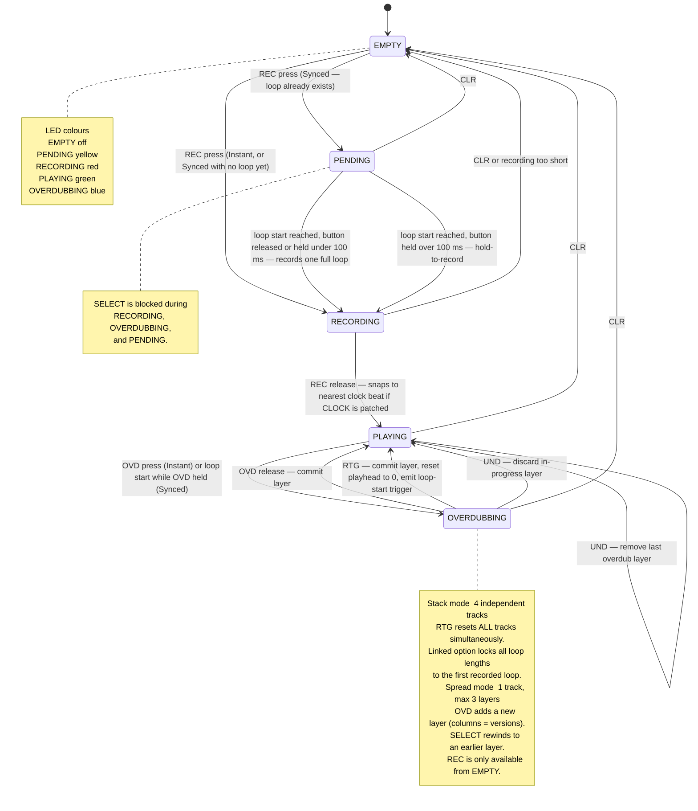

# Repool — User Logic

Each of the four tracks (Stack mode) or the single track (Spread mode) runs the following state machine. The active state is reflected by the **STATE LED** colour.

## Controls at a glance

| Button         | Action                                                                                                             |
| -------------- | ------------------------------------------------------------------------------------------------------------------ |
| **SELECT 1–4** | Choose active track (Stack) or rewind to layer version (Spread). Blocked while recording, overdubbing, or pending. |
| **REC**        | Hold to record. Release commits the loop (clock-quantized if patched).                                             |
| **OVD**        | Hold to overdub. Release commits the layer.                                                                        |
| **UND**        | Remove last committed layer, or discard an in-progress overdub.                                                    |
| **CLR**        | Clear the selected track back to EMPTY.                                                                            |
| **RTG**        | Reset all playing/overdubbing tracks to position 0. Fires a loop-start trigger on the LOOP START output.           |

## Outputs

| Output         | Signal                                                                           |
| -------------- | -------------------------------------------------------------------------------- |
| **AUDIO**      | Wet/dry mix controlled by the MIX knob.                                          |
| **POS**        | 0–10 V normalised playhead position of the master (first content-bearing) track. |
| **LOOP START** | 1 ms trigger on every loop wrap, and on every RTG press.                         |
